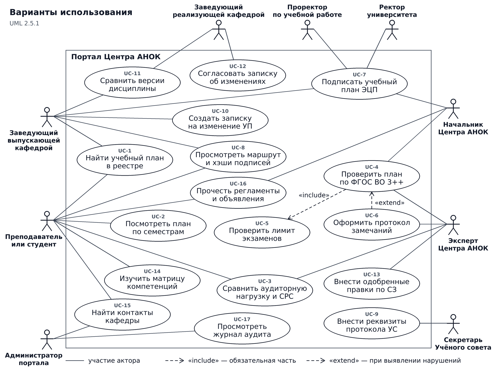

# Лабораторная работа № 1
## Выявление требований к порталу и составление их формализованного описания. Выбор инструментального средства для создания портала

**Вариант 15:** Университет. Центр аккредитации и независимой оценки качества образования (АНОК)  
**Дисциплина:** Практикум по разработке корпоративного портала  
**Исполнитель:** студент группы П-41 Соловьёв А.С.  
**Город, год:** Москва, 2026 г.

---

## 1. Цель работы

Целью лабораторной работы является исследование предметной области Центра аккредитации и независимой оценки качества образования университета (Центр АНОК), выявление и формализация функциональных и нефункциональных требований к корпоративному порталу, разработка диаграммы вариантов использования (Use Case Diagram), а также сравнение CMS на PHP с поддержкой MySQL и обоснование выбора бесплатной CMS для портала.

---

## 2. Описание предметной области

Центр АНОК выполняет ключевую роль в обеспечении соответствия образовательной деятельности университета требованиям Федеральных государственных образовательных стандартов высшего образования (ФГОС ВО 3++), локальных нормативных актов и регламентов аккредитационной экспертизы.

Ключевым объектом автоматизации является **Учебный план (УП)** образовательной программы высшего образования, представляющий собой сложную структурированную сетку дисциплин, практик и государственной итоговой аттестации (ГИА), распределенных по семестрам с фиксацией академических часов (лекции, лабораторные, практические, самостоятельная работа студента — СРС), зачетных единиц (з.е.) и форм промежуточного контроля (экзамен, зачет, зачет с оценкой, курсовой проект/работа).

### Основные бизнес-процессы Центра АНОК:
1. **Инициация и разработка проекта УП:** Выпускающие кафедры формируют проект учебного плана образовательной программы бакалавриата (240 з.е.) или магистратуры (120 з.е.).
2. **Экспертиза и автоматическая валидация:** Центр АНОК выполняет проверку плана на выполнение обязательных ограничений ФГОС ВО 3++:
   * Суммарная трудоемкость программы (240 з.е. для бакалавриата, ровно 30 з.е. в каждом семестре);
   * Количество экзаменов в одну экзаменационную сессию ($\le 5$ экзаменов);
   * Объем практической подготовки ($\ge 12$ з.е.);
   * Объем государственной итоговой аттестации ($\ge 6$ з.е.);
   * Корректность закрепления дисциплин за обеспечивающими кафедрами.
3. **Маршрут согласования и утверждения:** Проект УП последовательно визируется: Заведующий выпускающей кафедрой $\rightarrow$ Эксперт/Начальник АНОК $\rightarrow$ Проректор по учебной работе $\rightarrow$ Ректор университета с фиксацией номера и даты протокола Ученого совета.
4. **Внесение оперативных изменений (Служебные записки):** При необходимости перераспределения часов, смены формы контроля или обеспечивающей кафедры оформляется электронная служебная записка (СЗ) с двусторонним согласованием (выпускающая + реализующая кафедры) и проверкой сохранения итогового баланса зачетных единиц.

---

## 3. Описание основных акторов системы

| Актор | Роль в системе | Основные функции и зоны ответственности |
|---|---|---|
| **Руководитель выпускающего подразделения (Зав. кафедрой)** | `HEAD_RELEASING` | Формирование проектов учебных планов ОП, первичное визирование ЭЦП, создание служебных записок на корректировку дисциплин. |
| **Руководитель реализующего подразделения (Обеспечивающая каф.)** | `HEAD_IMPLEMENTING` | Согласование параметров закрепленных дисциплин (часы, формы контроля), визирование служебных записок. |
| **Эксперт Центра АНОК** | `EXPERT_ANOK` | Проведение автоматизированной и содержательной экспертизы УП по ФГОС ВО 3++, фиксация замечаний, применение утвержденных служебных записок. |
| **Начальник Центра АНОК** | `HEAD_ANOK` | Утверждение результатов аккредитационной экспертизы, наложение визы АНОК в маршруте согласования. |
| **Проректор по учебной работе** | `VICE_RECTOR` | Согласование учебного плана на уровне руководства университета перед вынесением на Ученый совет. |
| **Ректор университета** | `RECTOR` | Финальное утверждение учебного плана на основании решения Ученого совета университета. |
| **Секретарь Ученого совета** | `COUNCIL_SEC` | Регистрация реквизитов протоколов заседаний Ученого совета по утверждению и актуализации ОП. |
| **Преподаватель / Студент** | `VIEWER` | Просмотр утвержденных учебных планов, матриц компетенций, календарных графиков и объявлений. |
| **Администратор портала** | `ADMIN` | Управление пользователями, ролями, нормативными справочниками ФГОС, аудит безопасности и мониторинг. |

*Примечание.* Акторы «Секретарь Ученого совета» (`COUNCIL_SEC`) и «Преподаватель / Студент» (`VIEWER`) участвуют в диаграмме вариантов использования как внешние роли предметной области; системные учетные записи предусмотрены для остальных семи ролей (справочник `roles`, таблица `users`).

---

## 4. Диаграмма вариантов использования (Use Case)

Рисунок показывает цели девяти ролей из раздела 3. Сплошные линии означают участие в прецедентах, а не порядок действий.

### Основные группы прецедентов:
* **Учебные планы (UC-1–UC-3):** поиск в реестре, просмотр по семестрам с фильтром по кафедре, анализ нагрузки и СРС.
* **Экспертиза:** проверка по ФГОС всегда включает контроль лимита экзаменов в сессию (UC-4 «include» UC-5). Если при оценке результата выявлены нарушения, эксперт оформляет протокол замечаний (UC-6 «extend» UC-4).
* **Согласование (UC-7–UC-9):** четыре подписанта визируют план; маршрут и хэши SHA-256 доступны для просмотра. План утверждает ректор, реквизиты протокола вносит секретарь.
* **Служебные записки (UC-10–UC-13):** создание, сравнение версий, согласование кафедрой. Эксперт применяет одобренные изменения.
* **Справка и аудит (UC-14–UC-17):** матрица компетенций, контакты кафедр, регламенты и объявления, просмотр журнала действий.

---

## 5. Требования к корпоративному порталу

### 5.1. Функциональные требования
1. **ФТ-01 (Хранение ОП и УП):** Хранение реестра образовательных программ с кодами направлений, уровнями образования, формами обучения и связанными версиями учебных планов.
2. **ФТ-02 (Сетка дисциплин):** Хранение дисциплин с детализацией по семестрам (1–8), зачетным единицам, общим часам, часам лекций, лабораторных, практик, СРС и формам контроля.
3. **ФТ-03 (Семестровая навигация):** Интерактивный просмотр учебного плана с переключением семестров и автоматическим расчетом промежуточных итогов.
4. **ФТ-04 (Нормативы ФГОС):** Ведение справочника стандартов ФГОС ВО 3++ с пороговыми значениями (общие кредиты, макс. экзаменов, мин. практик, мин. ГИА).
5. **ФТ-05 (Валидация):** Автоматическая проверка плана на соответствие критериям ФГОС с индикацией статуса.
6. **ФТ-06 (Маршрут согласования):** Фиксация шагов визирования УП, ФИО подписантов, дат, статусов и криптографических хэшей подписей.
7. **ФТ-07 (Служебные записки):** Формирование СЗ с фиксацией выпускающей и реализующей кафедр, текстового обоснования и дифференциальных изменений дисциплин.
8. **ФТ-08 (Матрица компетенций):** Хранение и отображение категорий компетенций (УК, ОПК, ПК), их формулировок и дескрипторов.
9. **ФТ-09 (Справочник кафедр):** Ведение структуры подразделений с разделением на выпускающие, реализующие, экспертные и руководящие.
10. **ФТ-10 (Объявления):** Публикация регламентов и объявлений с поддержкой закрепления важных записей.
11. **ФТ-11 (Журнал аудита):** Протоколирование всех операций (время, пользователь, роль, действие, объект, статус, IP-адрес).
12. **ФТ-12 (Карта сайта):** Наличие интерактивной карты сайта со всеми разделами системы.

### 5.2. Нефункциональные требования
1. **НФТ-01 (Производительность):** Время отклика сервера при формировании страниц не должно превышать 200 мс при стандартной нагрузке.
2. **НФТ-02 (Надежность и транзакционность):** Целостность данных обеспечивается связями первичных и внешних ключей (`Foreign Keys`).
3. **НФТ-03 (Безопасность):** Использование подготовленных запросов (`Prepared Statements`) для исключения SQL-инъекций; экранирование вывода HTML (`htmlspecialchars`) для защиты от XSS.
4. **НФТ-04 (Кроссплатформенность и переносимость):** Возможность автономного развертывания как на стеке PHP/MySQL, так и на легковесном стеке Python/SQLite без внешних закрытых зависимостей.
5. **НФТ-05 (Адаптивность):** Корректное отображение на мониторах ПК, планшетах и мобильных устройствах.
6. **НФТ-06 (Эргономика):** Единый строгий корпоративный стиль оформления с визуальным цветовым кодированием статусов документов.

---

## 6. Сравнительный анализ инструментальных программных средств

Для портала Центра АНОК сравниваются Drupal 11, Joomla и «1С-Битрикс: Управление сайтом». Drupal и Joomla распространяются бесплатно; «1С-Битрикс» включён в сравнение как коммерческая альтернатива. Стоимость лицензии не входит в балльную оценку. Балл от 1 до 5 — экспертная оценка того, насколько CMS отвечает требованиям портала по данному критерию; 5 — лучшее соответствие.

Наибольший вес имеют связи между программами, планами и дисциплинами (30 %), разграничение доступа при согласовании (25 %) и построение реестров с выборками по семестру и кафедре (20 %). Ещё 15 % отведено добавлению предметной логики, например проверки ФГОС, и 10 % — простоте первоначальной настройки.

| Критерий | Вес | Drupal 11 | Joomla | 1С-Битрикс |
|---|---:|---:|---:|---:|
| Связанные данные | 30 % | 5 | 3 | 4 |
| Роли и доступ | 25 % | 5 | 5 | 5 |
| Списки и выборки | 20 % | 5 | 3 | 4 |
| Расширение логикой | 15 % | 4 | 4 | 4 |
| Простота настройки | 10 % | 2 | 4 | 2 |
| Итог с весами | 100 % | 4,55 | 3,75 | 4,05 |

Итог — сумма произведений баллов на веса, выраженные долями единицы. Например, для Drupal: 5 × 0,30 + 5 × 0,25 + 5 × 0,20 + 4 × 0,15 + 2 × 0,10 = 4,55 балла из 5.

### Обоснование выбора

**Для портала Центра АНОК выбрана CMS Drupal 11.** Ссылки между сущностями позволяют связать учебный план с программой и дисциплинами, роли и разрешения — разграничить действия участников согласования, а модуль Views — собрать реестр планов с фильтрами. По этим трём критериям Drupal получил по 5 баллов. «1С-Битрикс» получил те же 5 баллов за разграничение доступа. Разницу в 0,50 балла дали связанные данные и выборки: для реестров учебных планов ссылки на сущности и Views в Drupal оценены выше, чем связи инфоблоков и фильтры компонентов в «1С-Битрикс».

Выбор CMS относится к проекту портала. Демонстрационный стенд реализован отдельно на Python и SQLite.

---

## 7. Заключение

В рамках лабораторной работы № 1 полностью исследована предметная область Центра АНОК университета, выделены 9 акторов, разработана диаграмма вариантов использования (Use Case), сформулированы 12 функциональных и 6 нефункциональных требований, проведено сравнение трёх CMS. По взвешенной оценке для портала выбрана CMS Drupal 11.
