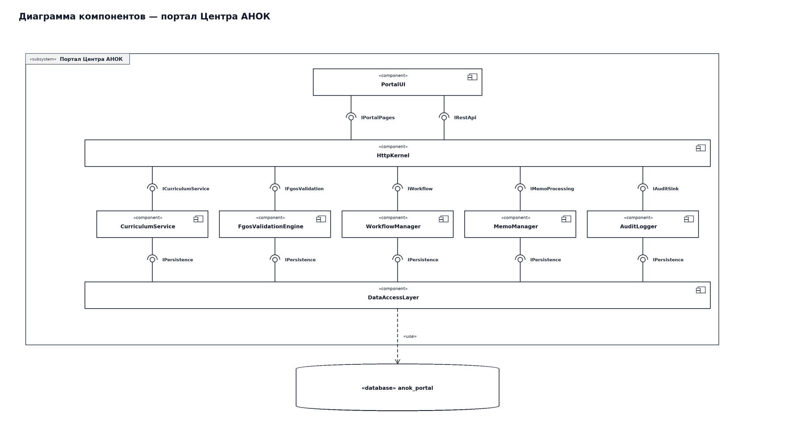
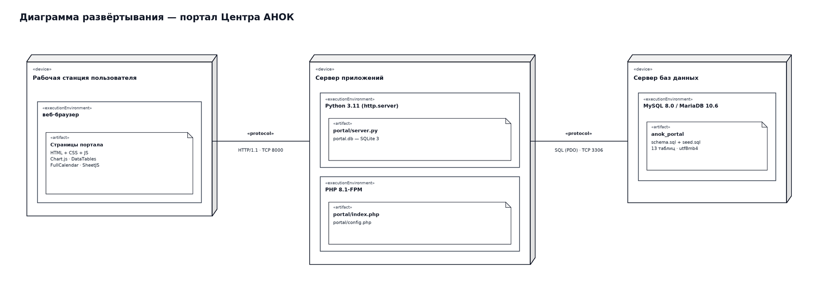
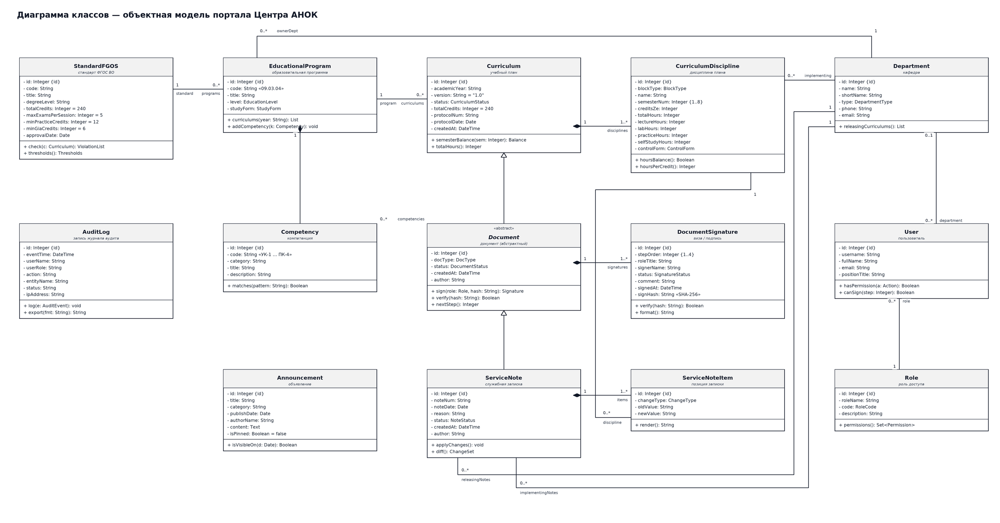
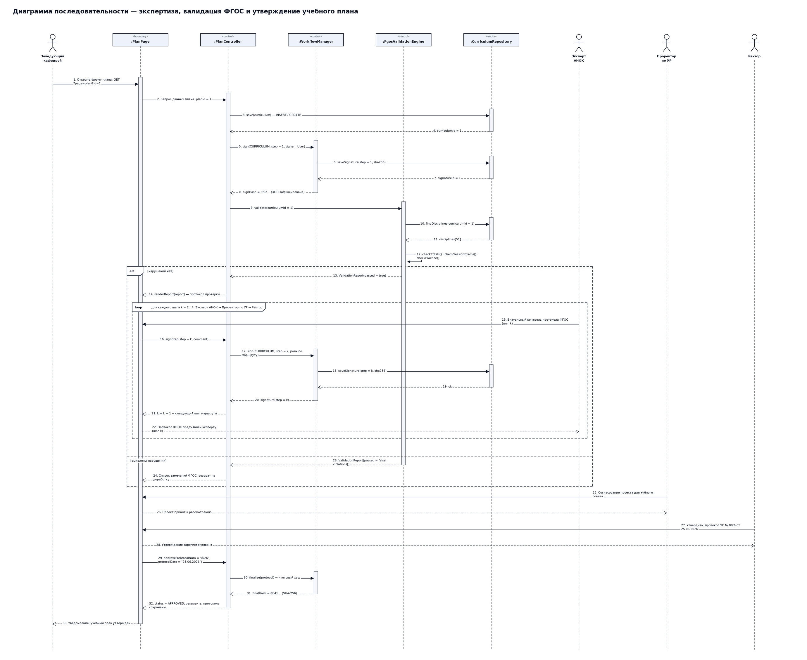
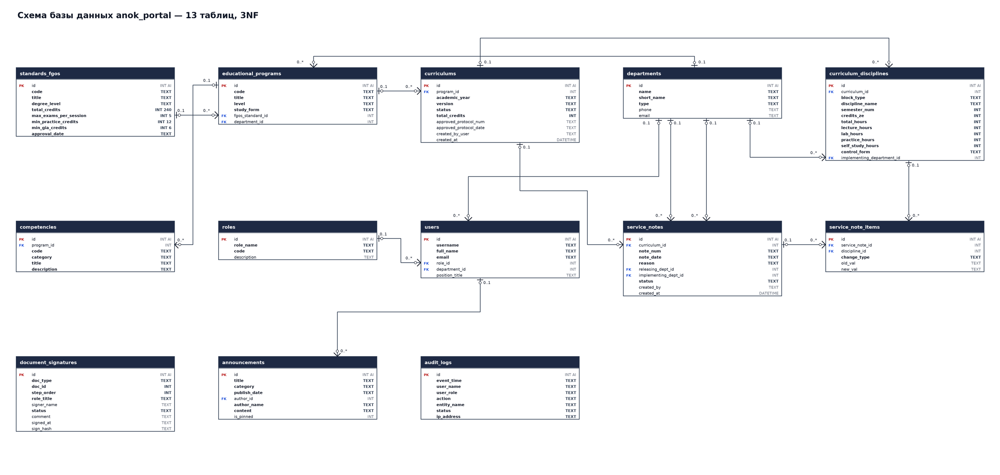
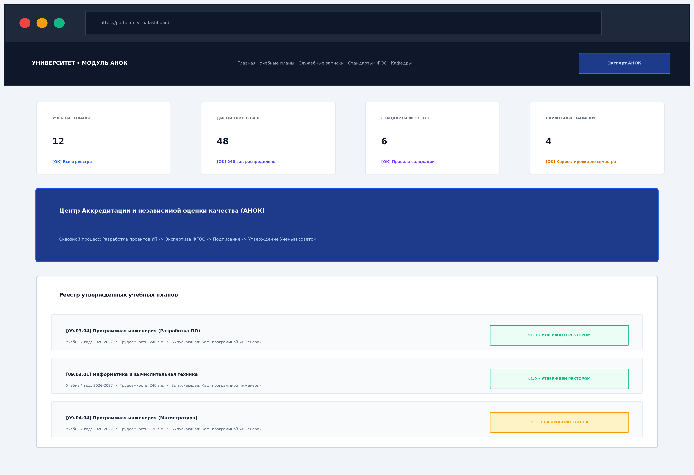
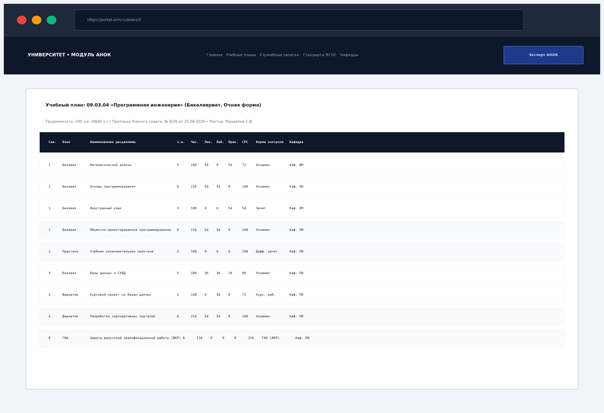
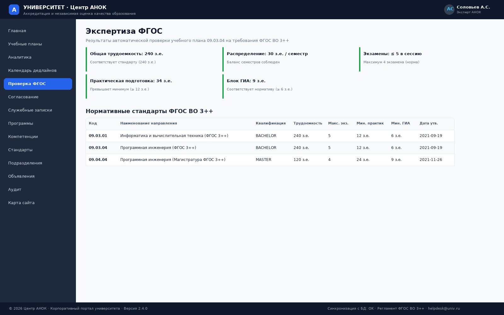
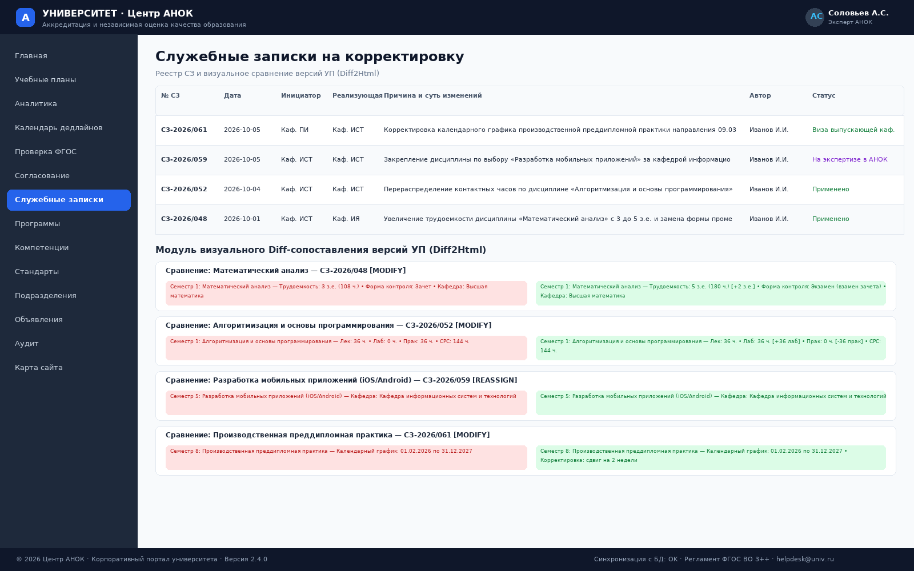

# Лабораторная работа № 2
## Анализ и проектирование портала. Развёртывание программного обеспечения

**Вариант 15:** Университет. Центр аккредитации и независимой оценки качества образования (АНОК)  
**Дисциплина:** Практикум по разработке корпоративного портала  
**Исполнитель:** студент группы П-41 Соловьёв А.С.  
**Город, год:** Москва, 2026 г.

---

## 1. Цель работы

Разработать комплекс архитектурных моделей корпоративного портала Центра АНОК (диаграмму компонентов, диаграмму развертывания, диаграмму классов, диаграмму последовательности и реляционную схему базы данных), спроектировать структуру таблиц базы данных в формате SQL DDL, развернуть серверное программное обеспечение и продемонстрировать примеры функционирования портала.

---

## 2. Архитектурное проектирование портала

### 2.1. Диаграмма компонентов (Component Diagram)

Диаграмма компонентов выполнена в нотации UML 2.5 и описывает модульную структуру портала и распределение обязанностей между уровнями представления, бизнес-логики и хранения данных. Каждый модуль изображён прямоугольником с ключевым словом `«component»` и пиктограммой компонента; **предоставляемый интерфейс** показан «шариком», **требуемый интерфейс** — «гнездом», а их соединение образует сборочный разъём (assembly connector). Все прикладные модули заключены в границу подсистемы (`«subsystem»` Портал Центра АНОК), а сами соединения выполнены **сборочными разъёмами** — «шарик» поставщика надет в «гнездо» потребителя, поэтому по рисунку сразу видно, кто предоставляет контракт, а кто его требует. Зависимости направлены строго сверху вниз (интерфейс → ядро → сервисы → доступ к данным), обратных зависимостей нет; хранилище вынесено за границу подсистемы, и единственный путь к нему — `DataAccessLayer`. Зависимость «use» (пунктирная стрелка) показана только там, где формального интерфейса нет — при обращении к СУБД.



* **Клиентский уровень — `PortalUI`:** рендеринг HTML/CSS-интерфейса, интерактивное переключение вкладок семестров, динамическая фильтрация таблиц на JavaScript. Компонент **требует** два интерфейса: `IPortalPages` (серверный HTML страниц) и `IRestApi` (JSON-эндпоинты), которые **предоставляет** `HttpKernel`.
* **Уровень маршрутизации и контроллеров — `HttpKernel`:** принимает входящие HTTP GET/POST-запросы, выполняет диспетчеризацию страниц (`dashboard`, `plans`, `plan`, `analytics`, `calendar`, `validate`, `signatures`, `memos`, `programs`, `competencies`, `standards`, `departments`, `announcements`, `audit`, `sitemap`), REST-эндпоинтов (`/api/stats`, `/api/plans`, `/api/announcements`), а также аутентификацию, ролевую авторизацию (`RoleCode`) и проверку CSRF-токена. Компонент **требует** пять интерфейсов уровня бизнес-логики: `ICurriculumService`, `IFgosValidation`, `IWorkflow`, `IMemoProcessing`, `IAuditSink`.
* **Уровень бизнес-логики:**
  * `CurriculumService` — расчёт кредитов и часов, балансировка семестровой нагрузки;
  * `FgosValidationEngine` — алгоритмическая проверка параметров плана на соответствие нормативам ФГОС ВО 3++;
  * `WorkflowManager` — управление цепочкой визирования и регистрация электронных цифровых подписей (ЭЦП, SHA-256);
  * `MemoManager` — обработка служебных записок на изменение дисциплин;
  * `AuditLogger` — сквозное протоколирование действий пользователей.
  Каждый сервис **предоставляет** свой интерфейс и **требует** `IPersistence` от слоя доступа к данным.
* **Уровень доступа к данным — `DataAccessLayer`:** единая точка доступа к БД для обеих реализаций портала (`sqlite3` в Python-версии, `PDO` в PHP-версии); включены внешние ключи (`PRAGMA foreign_keys = ON`), транзакции ACID, кодировка `utf8mb4`; схема и демо-данные создаются скриптами `schema.sql` и `seed.sql` (13 таблиц, 3NF). С хранилищем `«database» anok_portal` компонент связан зависимостью «use».

---

### 2.2. Диаграмма развёртывания (Deployment Diagram)

Диаграмма развёртывания отображает физическую топологию портала. Узлы изображены трёхмерными блоками со стереотипом `«device»`, среды исполнения — вложенными блоками `«executionEnvironment»`, развёртываемые файлы — символами `«artifact»`, а линии связи подписаны стереотипом `«protocol»` и номером TCP-порта. Компоненты не «разворачиваются» на узлах напрямую: артефакт связан с реализуемым компонентом пунктирной стрелкой `«manifest»` (артефакт «Страницы портала» манифестирует `PortalUI`, артефакты `portal/server.py` и `portal/index.php` — компонент `HttpKernel`), поэтому один и тот же компонент показан развёрнутым в двух альтернативных средах без дублирования элемента модели. На сервере БД компонент не манифестируется: база хранит состояние, а не реализует поведение портала.



* **Рабочая станция пользователя** (`«device»`): среда исполнения `«executionEnvironment» веб-браузер`, в которой развёрнут артефакт «Страницы портала» (HTML + CSS + JS); клиентские библиотеки Chart.js, DataTables, FullCalendar и SheetJS подключаются с CDN jsDelivr.
* **Сервер приложений** (`«device»`): две альтернативные среды исполнения — `Python 3.11 (http.server)` с артефактами `portal/server.py` и файловой БД `portal.db` (SQLite 3) и `PHP 8.1-FPM` с артефактами `portal/index.php` и `portal/config.php`. Взаимодействие с клиентом — `«protocol» HTTP/1.1` по TCP-порту 8000 (GET/POST, REST/JSON).
* **Сервер баз данных** (`«device»`): среда исполнения `MySQL 8.0 / MariaDB 10.6` (InnoDB, `utf8mb4`) с артефактом `anok_portal` — схемой из `schema.sql` и демо-данными `seed.sql`. Соединение с сервером приложений — `«protocol» SQL (PDO)` по TCP-порту 3306.
* Узлы CDN и сервера резервного копирования на рисунке не показаны, чтобы не перегружать топологию: библиотеки загружаются с jsDelivr по HTTPS (TCP 443), резервное копирование выполняется дампом БД по SFTP (TCP 22).

---

### 2.3. Диаграмма классов (Class Diagram)

Диаграмма классов описывает объектную модель предметной области в нотации UML 2.5: классы изображены прямоугольниками с тремя секциями (имя, атрибуты, операции), видимость членов указана знаками `+ public` и `− private`, типы атрибутов и параметров операций заданы после двоеточия, кратности — на концах связей, композиция — закрашенным ромбом у класса-«целого», генерализация — линией с полым треугольником. Абстрактный класс `Document` выделен курсивом и свойством `{abstract}` (угловые кавычки-ёлочки в UML 2.5 зарезервированы под стереотипы, поэтому абстрактность помечена не ими, а ограничением в фигурных скобках). Кратность на каждом конце связи стоит рядом с этим концом и читается по правилу «сколько экземпляров класса на противоположном конце связано с одним экземпляром этого класса»; имя роли записано у своего конца со стороны линии.



* `Document` (`{abstract}`) — обобщение документов портала: содержит идентификатор, тип документа, статус, автора и операции `sign()`, `verify()`, `nextStep()`. Наследниками являются `Curriculum` (учебный план) и `ServiceNote` (служебная записка), что отражает полиморфную ссылку `doc_type / doc_id` таблицы `document_signatures`.
* `Curriculum` (Учебный план) — **композицией** агрегирует коллекцию дисциплин `CurriculumDiscipline` (дисциплина не существует вне плана), связан ассоциацией с образовательной программой `EducationalProgram` и содержит реквизиты протокола утверждения.
* `CurriculumDiscipline` (Дисциплина плана) — атрибуты трудоёмкости (`creditsZe`, `totalHours`, `lectureHours`, `labHours`, `practiceHours`, `selfStudyHours`), номер семестра `{1..8}`, форма контроля и ссылка на обеспечивающую кафедру `Department` (роль `implementing`).
* `StandardFGOS` (Стандарт ФГОС) — нормативные пороги (`totalCredits = 240`, `maxExamsPerSession = 5`, `minPracticeCredits = 12`, `minGiaCredits = 6`) и операция `check(curriculum: Curriculum)`.
* `EducationalProgram` — образовательная программа: связана со стандартом ФГОС, выпускающей кафедрой и **композицией** с матрицей компетенций `Competency`.
* Атрибуты, объявленные в `Document` (`id`, `docType`, `status`, `createdAt`, `author`), не дублируются у наследников `Curriculum` и `ServiceNote`: при обобщении атрибут объявляется один раз в классе-владельце, а наследники наследуют его, поэтому в их секциях остаются только собственные поля (`academicYear`, `noteNum`, `reason` и т. п.).
* `ServiceNote` и `ServiceNoteItem` — заявка на изменение дисциплины («Было» → «Стало») с ролями `releasingNotes` / `implementingNotes` между кафедрами и маршрутом согласования `DocumentSignature` (шаги `{1..4}`, ЭЦП `signHash` SHA-256).
* `User` и `Role` — идентификация пользователей и ролевое разграничение прав доступа (`code: RoleCode`).
* `AuditLog` — неизменяемый (append-only) журнал событий безопасности: ФИО и роль автора хранятся снимком (`userName`, `userRole`), внешний ключ на `users` не объявляется, чтобы запись оставалась достоверной и после переименования или удаления пользователя.
* `Announcement` — лента объявлений и регламентов: автор объявления связан с пользователем ассоциацией `0..* — 0..1` (колонка `author_id` → `users`, роль `author`; кратность `0..1` повторяет допустимый `NULL` внешнего ключа), а `authorName` хранится снимком для отображения в списке.

---

### 2.4. Диаграмма последовательности (Sequence Diagram)

Диаграмма последовательности отражает сквозной сценарий экспертизы, автоматической валидации и утверждения учебного плана. Участники изображены заголовками линий жизни со стереотипами `«boundary»` (страница), `«control»` (управляющий объект) и `«entity»` (сущность), актёры — стилизованными фигурками. Сплошные стрелки обозначают синхронные сообщения, пунктирные с открытой стрелкой — возврат управления, вертикальные прямоугольники — периоды активности (activation), рамки `alt` и `loop` — комбинированные фрагменты.



1. Заведующий выпускающей кафедрой открывает форму плана (`1`), приложение запрашивает данные (`2`) и сохраняет проект учебного плана через `:CurriculumRepository` (`3`, `4`).
2. `:WorkflowManager` регистрирует первичную ЭЦП заведующего кафедрой: формирование и сохранение `signHash` (`5`–`8`).
3. Система запускает `:FgosValidationEngine` (`9`), который загружает дисциплины плана (`10`, `11`) и выполняет проверку контрольных соотношений: 240 з.е., баланс 30 з.е. в семестре, ≤ 5 экзаменов в сессию, ≥ 12 з.е. практик, ≥ 6 з.е. ГИА (`12`).
4. Комбинированный фрагмент `alt` разводит две ветви: при отсутствии нарушений формируется протокол проверки (`13`, `14`), при выявленных нарушениях план возвращается на доработку со списком замечаний ФГОС (`15`, `16`).
5. Фрагмент `loop` описывает маршрут визирования для шагов 2–4 (Эксперт Центра АНОК → Проректор по учебной работе → Ректор): визуальный контроль протокола (`17`), наложение визы (`18`–`22`), переход к следующему шагу (`23`) и предъявление протокола проверки эксперту (`23.1`).
6. Ректор утверждает учебный план с фиксацией реквизитов протокола Учёного совета (№ 8/26 от 25.06.2026) и формированием финального цифрового хэша (`24`–`28`; `24.1` и `25.1` — подтверждения приёма проекта к рассмотрению и регистрации утверждения), после чего статус плана меняется на `APPROVED`, а инициатор получает уведомление (`29`, `30`).

---

## 3. Схема и структура базы данных

Реляционная база данных портала `anok_portal` спроектирована в 3-й нормальной форме (3NF) и включает 13 взаимосвязанных таблиц с объявленными в DDL ограничениями внешних ключей (`FOREIGN KEY`). Схема приведена в стандартной нотации «воронья лапка» (crow's foot): в каждой таблице перечислены столбцы с типами, первичные ключи помечены `PK`, внешние — `FK`; полужирным начертанием типа отмечены обязательные поля (`NOT NULL`). Сторона «многие» обозначена «вороньей лапкой», сторона «один» — чертой, кружок у окончания связи показывает необязательность (`nullable` внешний ключ), а кратности `0..*` и `0..1` подписаны на концах линий.



### Спецификация таблиц базы данных:

1. **`educational_programs` (Образовательные программы):**
   * `id` (PK), `code` (код направления, напр. 09.03.04), `title` (наименование), `level` (уровень образования), `study_form` (форма обучения), `fgos_standard_id` (FK $\rightarrow$ `standards_fgos`), `department_id` (FK $\rightarrow$ `departments`).
2. **`standards_fgos` (Нормативы ФГОС ВО 3++):**
   * `id` (PK), `code` (код стандарта), `title` (название), `degree_level` (квалификация), `total_credits` (норма з.е.), `max_exams_per_session` (макс. экзаменов), `min_practice_credits` (мин. практик), `min_gia_credits` (мин. ГИА), `approval_date` (дата утверждения).
3. **`curriculums` (Реестр учебных планов):**
   * `id` (PK), `program_id` (FK $\rightarrow$ `educational_programs`), `academic_year` (учебный год), `version` (версия), `status` (статус УП), `total_credits` (суммарная трудоемкость), `approved_protocol_num`, `approved_protocol_date`, `created_by_user`, `created_at`.
4. **`curriculum_disciplines` (Дисциплины учебного плана):**
   * `id` (PK), `curriculum_id` (FK $\rightarrow$ `curriculums`), `block_type` (индекс блока: Б1.О, Б1.В, Б2, Б3, ФТД), `discipline_name`, `semester_num` (1..8), `credits_ze`, `total_hours`, `lecture_hours`, `lab_hours`, `practice_hours`, `self_study_hours`, `control_form`, `implementing_department_id` (FK $\rightarrow$ `departments`).
5. **`competencies` (Матрица компетенций):**
   * `id` (PK), `program_id` (FK), `code` (УК-1..8, ОПК-1..6, ПК-1..4), `category` (категория), `title`, `description`.
6. **`departments` (Структурные подразделения):**
   * `id` (PK), `name` (полное наименование), `short_name`, `type` (`RELEASING`, `IMPLEMENTING`, `EXPERT_ANOK`, `MANAGEMENT`), `phone`, `email`.
7. **`document_signatures` (Маршрут согласования и ЭЦП):**
   * `id` (PK), `doc_type`, `doc_id`, `step_order` (1..4), `role_title`, `signer_name`, `status`, `comment`, `signed_at`, `sign_hash` (SHA-256).
   * Связь (`doc_type`, `doc_id`) полиморфная — она ссылается либо на `curriculums`, либо на `service_notes`, поэтому внешний ключ в DDL не объявляется: целостность обеспечивает `WorkflowManager` при регистрации визы.
8. **`service_notes` (Служебные записки на корректировку):**
   * `id` (PK), `curriculum_id` (FK), `note_num`, `note_date`, `reason`, `releasing_dept_id` (FK), `implementing_dept_id` (FK), `status`, `created_by`, `created_at`.
9. **`service_note_items` (Детализация изменений по СЗ):**
   * `id` (PK), `service_note_id` (FK), `discipline_id` (FK), `change_type`, `old_val`, `new_val`.
10. **`roles` (Справочник ролей):** `id` (PK), `role_name`, `code`, `description`.
11. **`users` (Пользователи системы):** `id` (PK), `username`, `full_name`, `email`, `role_id` (FK), `department_id` (FK), `position_title`.
12. **`announcements` (Объявления и регламенты):** `id` (PK), `title`, `category`, `publish_date`, `author_id` (FK → `users`, допускает NULL), `author_name` (снимок для отображения), `content`, `is_pinned`.
13. **`audit_logs` (Журнал аудита событий):** `id` (PK), `event_time`, `user_name`, `user_role`, `action`, `entity_name`, `status`, `ip_address`.

Исходные DDL-скрипты создания схемы расположены в `portal/database/schema.sql`, а демонстрационные данные — в `portal/database/seed.sql`.

---

## 4. Развёртывание и настройка программного обеспечения

### Вариант 1: Быстрый запуск (Python / встроенный SQLite)
Сервер портала поддерживает автономный запуск без внешних зависимостей. При первом старте база данных автоматически инициализируется из `schema.sql` и `seed.sql`:

```bash
# Запуск из корневой папки проекта
python3 server.py

# Или прямой запуск из директории портала
python3 portal/server.py
```
Сервер стартует по адресу: `http://0.0.0.0:8000`.

### Вариант 2: Запуск на стеке PHP и MySQL/MariaDB
1. Создать базу данных с кодировкой UTF-8:
   ```bash
   mysql -u root -p -e "CREATE DATABASE anok_portal CHARACTER SET utf8mb4 COLLATE utf8mb4_unicode_ci;"
   ```
2. Импортировать структуру таблиц и сиды:
   ```bash
   mysql -u root -p anok_portal < portal/database/schema.sql
   mysql -u root -p anok_portal < portal/database/seed.sql
   ```
3. Сконфигурировать переменные окружения и запустить встроенный PHP-сервер:
   ```bash
   export DB_HOST=127.0.0.1
   export DB_PORT=3306
   export DB_NAME=anok_portal
   export DB_USER=root
   export DB_PASSWORD=your_password
   php -S 0.0.0.0:8000 -t portal
   ```

---

## 5. Примеры работы установленного и настроенного ПО

После развертывания сервер отвечает на HTTP-запросы и отдает динамически сформированные страницы всех ключевых разделов портала. Ниже приведены примеры работающих страниц развернутого экземпляра портала (демонстрационная база `anok_portal`: 1 учебный план, 51 дисциплина, 3 стандарта ФГОС ВО 3++, 4 служебные записки, 9 подразделений, 7 записей аудита).

### 5.1. Сводная панель (`?page=dashboard`)
Стартовая страница портала отображает агрегированные карточки показателей (учебные планы, дисциплины, стандарты ФГОС, служебные записки), реестр учебных планов с быстрым переходом к детальному просмотру и ленту закрепленных объявлений Центра АНОК:



### 5.2. Просмотр учебного плана (`?page=plan&id=1&sem=1..8`)
Страница обеспечивает интерактивный просмотр учебного плана с переходом по семестрам (1–8) и контролем семестрового баланса: сумма 30 з.е. и 1080 академических часов на семестр, разбивка часов на лекции, лабораторные, практики и СРС, формы контроля и обеспечивающие кафедры. На приведенном снимке отображена сетка дисциплин плана 09.03.04 по семестру 1 (7 дисциплин, 30 з.е., 1080 часов: лекции 162 / лабораторные 72 / практики 234 / СРС 612) с обеспечивающими кафедрами; переключение семестров 1–8 выполняется навигационной панелью, суммарно план содержит 51 дисциплину (240 з.е., 8640 часов):



### 5.3. Автоматизированная экспертиза ФГОС (`?page=validate`)
Модуль валидации демонстрирует статус прохождения проверки по нормативам ФГОС ВО 3++: общая трудоемкость 240 з.е., баланс 30 з.е. в семестре, лимит экзаменов в сессию, объем практической подготовки и блока ГИА, а также справочник действующих стандартов:



### 5.4. Служебные записки на корректировку УП (`?page=memos`)
Раздел служебных записок фиксирует документооборот правок между выпускающей и обеспечивающей кафедрами: инициатор, согласующая кафедра, основание изменения, визуальное сравнение параметров дисциплины «Было» $\rightarrow$ «Стало» и статус рассмотрения заявки в Центре АНОК:



Все страницы формируются серверным движком из базы данных с использованием подготовленных параметризованных запросов, что подтверждает корректность развертывания и настройки программного обеспечения портала.

---

## 6. Заключение

В ходе выполнения лабораторной работы № 2 разработаны 5 архитектурных диаграмм в полной нотации UML 2.5 — компонентов (с интерфейсами «шарик–гнездо» в составе сборочных разъёмов), развёртывания (узлы `«device»`, среды исполнения, артефакты и протоколы связи), классов (видимость членов, типы, кратности у своих концов, композиция, генерализация, абстрактный класс `{abstract}`), последовательности (акторы, периоды активности, возвраты, фрагменты `alt` и `loop`) и реляционная схема базы данных в нотации «воронья лапка». Спроектирована 3NF-схема из 13 таблиц с объявленными внешними ключами, настроена серверная среда и выполнено успешное развертывание портала с демонстрационными данными.
