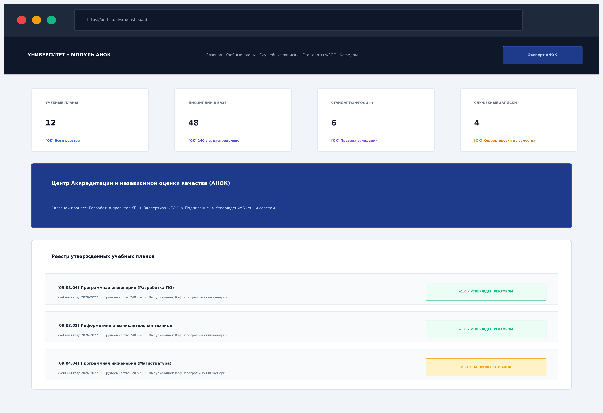
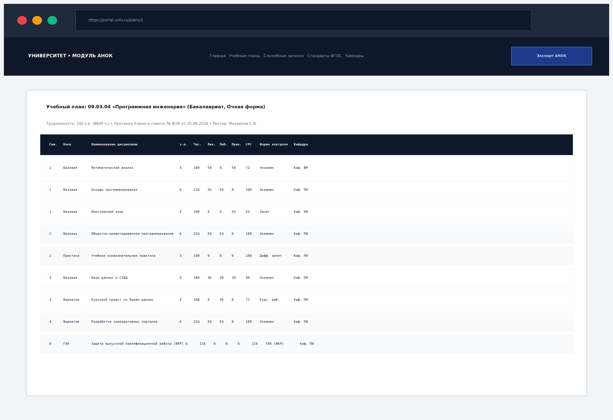
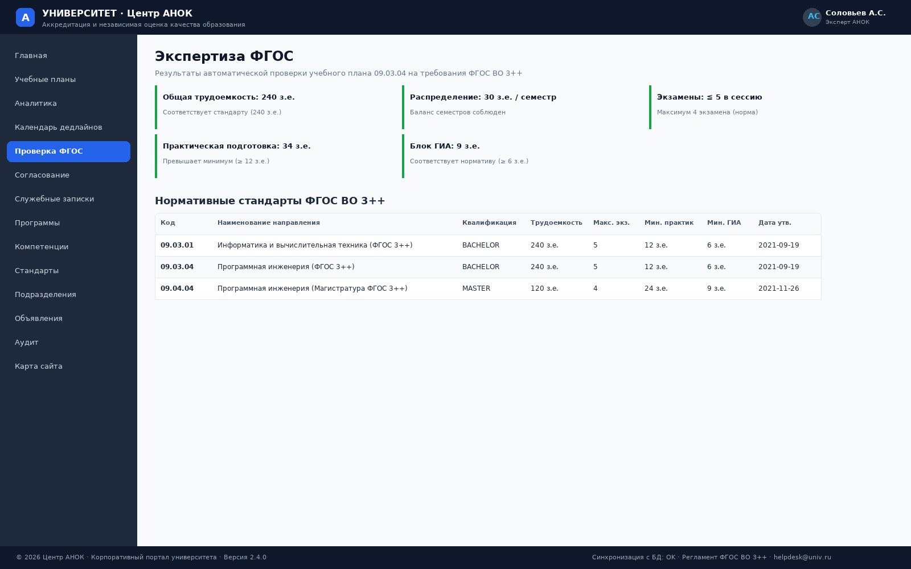

# Пояснительная записка

## 1. Назначение проекта

Портал объединяет открытые сведения Центра аккредитации и независимой оценки качества образования и рабочий кабинет сотрудника. В кабинете пользователь видит закреплённые за подразделением учебные планы, результаты автоматической экспертизы, маршрут визирования документов и служебные записки на корректировку дисциплин. Основной интерактивный сценарий — экспертиза проекта учебного плана на соответствие ФГОС ВО 3++ и его утверждение протоколом Учёного совета.

## 2. Требования и границы

Исходный вариант предусматривает учёт образовательных программ и нормативных стандартов, учебных планов с семестровой детализацией, компетенций и их матрицы, кафедр и их роли в реализации дисциплин, электронного визирования с штампами ЭЦП, служебных записок на изменение плана и журнала аудита. В ЛР1 эти процессы описаны как требования и варианты использования. Реализованный сайт покрывает часть процессов, достаточную для демонстрации структуры портала и основного сценария экспертизы и утверждения.

| Реализовано в работающем сайте | Отражено в модели и базе данных |
|---|---|
| Просмотр сводных показателей и реестра планов | Версии планов, статусы и реквизиты протокола |
| Семестровая карточка плана с поиском и экспортом | Дисциплины с разбивкой часов и зачётных единиц |
| Автоматическая экспертиза ФГОС | Нормативные пороги стандарта и контрольные соотношения |
| Маршрут визирования с проверкой SHA-256 | Этапы подписания и хэши ЭЦП |
| Служебные записки с сравнением версий | Журнал аудита, роли и пользователи |

## 3. Выбранные средства

Сайт развёрнут на Python 3.11 со встроенным многопоточным HTTP-сервером и реляционной СУБД SQLite 3 (предусмотрен запуск на MySQL 8 / MariaDB 10.6). Параметризованные запросы исключают SQL-инъекции. Предметный модуль `portal` содержит обработчики разделов, алгоритм валидации ФГОС и доступ к данным учебных планов. Единое оформление страниц задаёт встроенная тема на HTML5 и CSS3. Готовые модули подключены в ЛР6: Chart.js, FullCalendar, DataTables, SheetJS, jsPDF, CryptoJS, SweetAlert2, Toastify и Diff2Html.

## 4. Модель данных

Образовательная программа связана со стандартом ФГОС и выпускающей кафедрой, а учебный план — с программой и версией. Дисциплина плана хранит семестр, зачётные единицы, часы по видам занятий и реализующую кафедру. Компетенция связывается с программой отдельной матрицей. Этап подписания содержит роль, подписанта, дату и хэш SHA-256. Служебная записка и её позиции хранятся раздельно, чтобы фиксировать переход «Было» → «Стало». Схема данных и диаграммы классов приведены в отчёте ЛР2. Основные связи: программа — учебный план — дисциплина; компетенция — программа; документ — этап подписания; записка — позиция записки.

## 5. Структура и интерфейс

Главная страница ведёт к разделам «Учебные планы», «Экспертиза ФГОС», «Согласование», «Служебные записки», «Программы», «Компетенции», «Аналитика», «Календарь» и «Аудит». Дополнительные страницы объясняют порядок визирования и требования стандарта. Общая навигация сохраняется на внутренних страницах.

На странице плана приведены дисциплины по семестрам с балансом 30 з.е. и 1080 часов, формы контроля и обеспечивающие кафедры; таблица поддерживает живой поиск, сортировку и выгрузку в Excel и PDF. Раздел экспертизы формируется алгоритмом Центра АНОК и выводит контрольные соотношения по стандарту.

## 6. Клиентский сценарий

После входа заведующий кафедрой открывает проект плана, проверяет состав дисциплин, сохраняет проект и накладывает первичную ЭЦП. Система автоматически запускает проверку ФГОС: 240 з.е. общей трудоёмкости, 30 з.е. в семестре, не более пяти экзаменов в сессию, не менее 12 з.е. практик и 6 з.е. ГИА. При нарушениях план возвращается на доработку с перечнем замечаний. При отсутствии нарушений протокол предъявляется подписантам маршрута — эксперту Центра АНОК, проректору по учебной работе и ректору; каждый шаг фиксируется штампом ЭЦП с хэшем SHA-256. Завершает сценарий утверждение с реквизитами протокола Учёного совета и уведомление инициатора.

## 7. Результаты проверки

Проверены открытие главной страницы, реестра планов, экспертизы ФГОС, служебных записок и списка объявлений, работа поиска и сортировки, выгрузка плана в Excel и PDF, вывод информационных блоков и переходы между разделами. В ЛР2 отдельно проверены ограничение доступа к чужому документу, корректность автоматической валидации и совпадение пересчитанных хэшей SHA-256 с сохранёнными этапами подписания.

## 8. Состав результата и запуск

Отчёты ЛР1–7, пояснительная записка, презентация, исходный модуль `portal`, диаграммы и схема данных собраны в одном каталоге. Локальный стенд запускается командой `python portal/server.py`; после запуска портал доступен по адресу http://127.0.0.1:8000/. Для завершения работы достаточно прервать процесс. База данных `anok_portal` создаётся при первом обращении и наполняется демонстрационными данными автоматически.

## Заключение

Разработан работающий портал Центра аккредитации и независимой оценки качества образования. Подготовлены требования и модель данных, развёрнут сайт, выполнено оформление, опубликованы страницы, подключены штатные модули. Дальнейшее развитие связано с расширением матрицы компетенций и выгрузкой отчётов для аккредитационной экспертизы.
